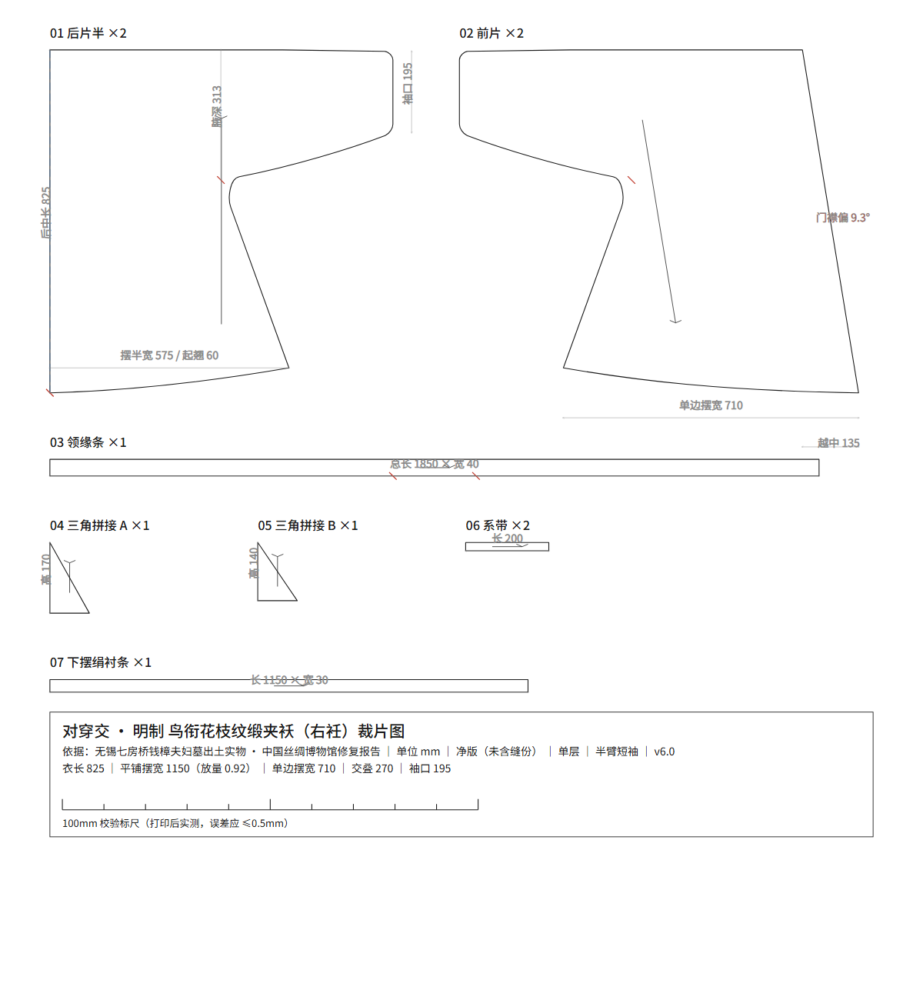
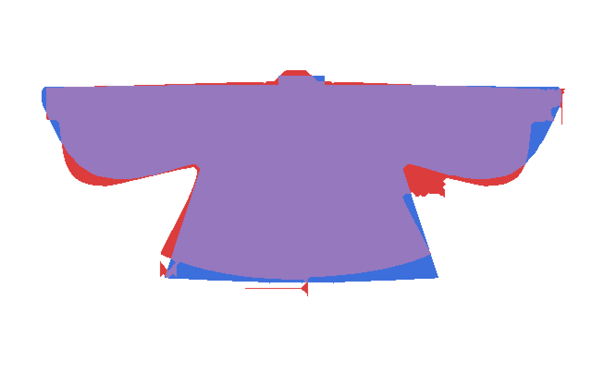

# 对穿交 · 汉服 CAD 打版（半臂）

把一件明代实物的成衣，逆向成可下厂的裁片图。

**形制**：对穿交（直领对襟的剪裁 + 交领的穿法，"二次成型"），本项目按**半臂**（无袖片、袖口止于上臂）出图。
**实物基准**：无锡七房桥钱樟夫妇墓 · 鸟衔花枝纹缎夹袄（明中后期，藏无锡博物院；中国丝绸博物馆 2014–2018 保护修复）。
**产出**：11 个尺码 × （SVG 裁片图 + DXF CAD 图 + 几何侧车 JSON），单位 mm，净版未含缝份。



## 这套东西特别在哪

不是"照着感觉画一张版"，而是每一步都有可复核的闸门：

| 闸门 | 做什么 | 结果 |
|---|---|---|
| 术语锚定 | 先把"对穿交"定义清楚，再动笔 | 推翻过一次方向性错误（见 `PLAN.md` v1.0→v2.0） |
| 量纲锚定 | 官图 → 实测值，优先图纸标注 > 网格 > 图内已知物 > 人体比例 | 3.89 mm/px，各向异性 ≤2% |
| **像素级叠合** | 裁片按真实拼合关系栅格化，与丝博官图做掩膜配准 + IoU/precision/recall | 正视 **0.8717**、背视 **0.8925** |
| 曲线规范 | 三次贝塞尔 + de Casteljau 精确切分 + 腋下 G1 混合圆角 | 消灭"棱角分明" |
| 尺寸自检 | `verification/verify.py` 28 项断言，期望值从 `build.py` 反读，避免两处漂移 | 28/28 PASS |

叠合示例（模型蓝 vs 官图红）：



## 快速开始

```bash
pip install ezdxf            # 唯一第三方依赖（出 DXF 用）

cd pattern

python make.py --sex 女 --size M          # 单码
python make.py --sex 女 --all             # 整档 XS~2XL
python make.py --sex 男 --all             # 男装 S~2XL（厂商表基准）
python make.py --sex 女 --height 163 --bust 86   # 直接给净尺寸
python make.py --sex 男 --size L --ease 宽松     # 放量档
```

产物落在 `out/<profile>_<性别>_<码>/`，同名三件套：`.svg` / `.dxf` / `.pieces.json`。
CAD 里直接 `OPEN` 那个 DXF 即可，毫米单位（`INSUNITS=4`），5 个图层：

| 图层 | 内容 |
|---|---|
| `CUT_轮廓` | 裁片净样闭合多段线 |
| `GRAIN_布纹` | 布纹线（带箭头） |
| `NOTCH_刀口` | 对位刀口 |
| `TEXT_文字` | 片名 ×数量 |
| `DIM_标注` | 100 mm 校验标尺 |

批量重出全部 11 个码：

```bash
python make.py --sex 女 --all && python make.py --sex 男 --all
```

## 两套基准

尺码工具支持两套 profile，`--profile` 不填时按性别自动选：

| 性别 | 默认基准 | 依据 | M 码关键值（mm） |
|---|---|---|---|
| 女 | `artifact` | 钱樟墓文物复原（过审版 v6） | 衣长 825｜平铺胸宽 822｜摆宽 1150｜袖口 195｜领缘 40 |
| 男 | `vendor` | 厂商实物出货尺码表（**最高置信度**） | 衣长 770｜平铺胸宽 570｜摆宽 798｜袖口 160｜领缘 70 |

推档档差取 GB/T 1335.1/.2-2008（身高 5 cm / 胸围 4 cm）。每个参数的出处、独立来源数、置信度见 `verification/尺码资料核验.md`——那里有一条硬口径：**同一篇文章被多站转载只算 1 个来源**。

## 目录

```
PLAN.md                    规划与形制论证（v2.0 为现行基准）
pattern/                   生成器
  build.py                 裁片几何（贝塞尔 + G1 混合 + 刀口）
  sizing.py                尺码/放量推档
  export_dxf.py            pieces.json → DXF
  make.py                  一键换码 CLI
verification/              校验
  overlay.py               像素级叠合（掩膜/配准/IoU）
  fit.py                   IoU 随机搜索拟合
  verify.py                尺寸自检 28 项
  report.py                生成比对报告
sources/                   原始资料（丝博官图 19 张、微博手绘、厂商尺码表）
archive/                   过审存档点（v3 文物原尺寸 / v6 半臂 放量0.92 / 废弃分支）
out/                       出图结果：11 个码 + 清单 + 尺码表
reverse/                   逆向中间产物（二值图、裁切块、局部放大）
```

## 已知残差

1. **袖上缘偏高 ~20 mm**：官图袖上缘自肩向袖口轻微下垂，现按 0.8° 处理，差约 5 px，属作图精度级。
2. **后领高度差 ~25 mm**：官图后领竖直段约 65 mm，本项目领缘条净宽 40 mm（女）/70 mm（男）。成品前建议按 60 mm 复核。
3. **下摆左右角**：摆宽取 1250 略大于官图实测，敏感度测试显示它不是 IoU 主因（1250→1000 仅 +0.5%）。

## 术语与史实备注

- 原件为**左衽**；本项目按用户指定出**右衽**。注意：**右衽不改变裁片**——两襟同形镜像，右衽只决定穿着时哪片在外。
- "对穿交"是民间俗称，非文物定名；定义依据孙韬《孙韬文集》4.3/4.4 与汉服颂《科普汉服领襟分类》。
- 摆宽 1250 并非随手取值：官图实测本就 ≈1150，放量系数 0.92 有客观依据。

## 许可

代码 MIT（见 `LICENSE`）。`sources/` 下的图片版权归原权利方（中国丝绸博物馆、微博作者、厂商），仅作研究与比对留证，不再分发授权。
