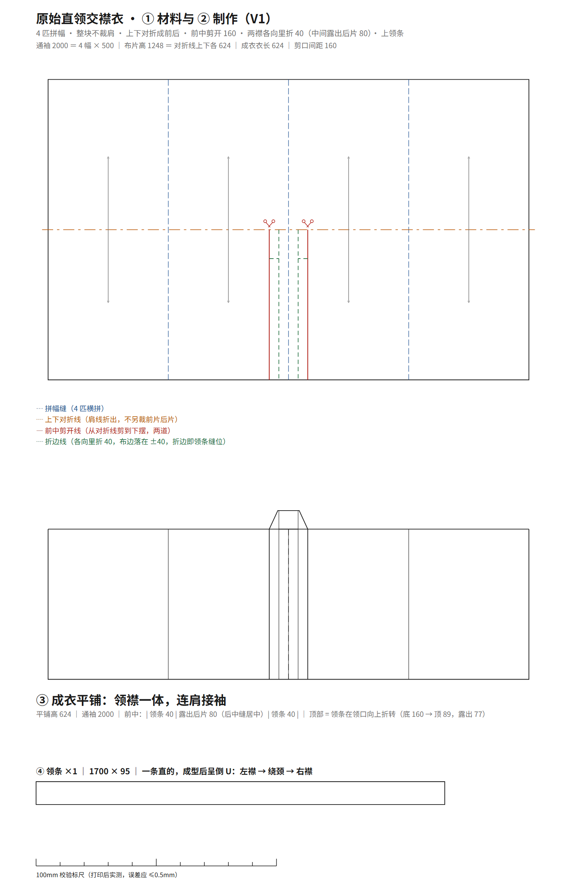
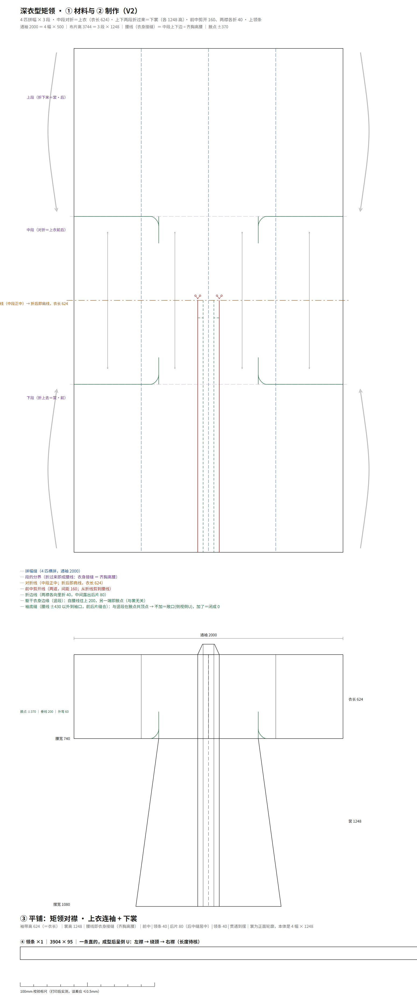
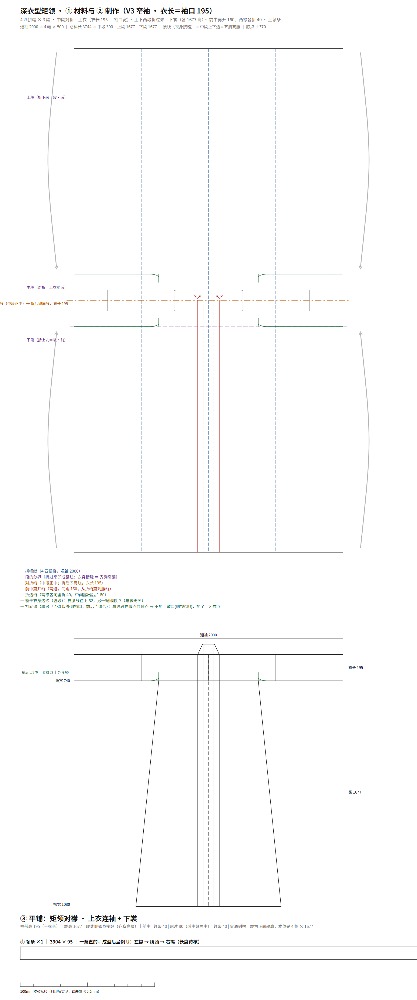

# 深衣型矩领 · 汉服 CAD 逆向

把孙韬关于"西周矩领"的过程图，逆向成可下厂的裁片图。工具链照搬 `../hanfu-cad`、
`../hanfu-jiexiu`（同一套 build/sizing/make/export_dxf/preview + 五图层 DXF 规范）。

## 体系位置：本项目是**通裁**，最近亲是长袖版（**分裁**）

同一支「对穿交」谱系里，这两个项目离得最近 —— 差别只在袖子的做法：

| | 本项目 `hanfu-shenyi`（深衣型矩领） | 长袖版 `../hanfu-jiexiu`（对穿交·接袖） |
|---|---|---|
| 裁法 | **通裁** | **分裁** |
| 衣身与袖 | 同一块布：中段对折，**布带的两端就是袖** | 衣身与接袖分开裁，缝一道**接袖缝** |
| 肩线 | **折出来**，不另裁前后片 | 另裁前后片（后片半 550×800 ×2、前片 685×800 ×2） |
| 片数 | **4 片**（上衣 / 裳·前 / 裳·后 / 领条） | **14 片 / 8 个品种**（含接袖 330×222 ×4、三角拼接、系带） |
| 通袖 | 2000 ＝ 4 幅 × 500 | 1630 ＝ (肩点 285 ＋ 衣身袖 200 ＋ 接袖 330) × 2 |
| 袖身关系 | **衣长 ＝ 袖肥 ＝ 袖口**（同一个数） | 袖根是派生值 222，腕口 130（掩腕） |

**共同点**：前中剪开 160、两襟各向里折 40、领条一条通到摆（领襟一体）、直丝、无里布。

**唯一的差别**：袖子是「另裁后缝上」（分裁）还是「同一块布通下来」（通裁）。
所以长袖版是最直接的参照 —— 它那道**接袖缝**（x = ±485 的垂直切口），正是本项目**没有**的那条线；
反过来，本项目「衣长＝袖口」这个等高关系，长袖版也**没有**（它是袖根 222、腕口 130）。
拿长袖版的推档与拼合逻辑来对标本项目时，**先减掉接袖那一段**再比。

## 三步走（2026-10-29 一晚跑完 V1 → V2 → V3）

| 版本 | 在上一版基础上改什么 | 状态 |
|---|---|---|
| **V1 原始直领交襟衣** | 4 匹拼幅 → 上下对折 → 前中剪开两道（间距 160）、两襟**各向里折 40** → 上领条 | ✅ 定稿归档 |
| **V2 深衣型矩领**（宽袖） | 材料 2 段 → **3 段**：中段对折成上衣，上下两段折过来当下裳；腰线 ＝ 中段上下边 | ✅ 定稿归档 |
| **V3 深衣型矩领**（窄袖） | 只动一个旋钮 `L_BODY`：624 → 195 | 🟡 已出图，待验收 |
| ~~矩领短衣~~ | 文章正文里的衍生款，**不在交付路线内**（2026-10-29 判定方向错了，已清理） | ✗ |

## 三版的差别只有两个数

| | `L_BODY`（衣长＝袖肥＝袖口） | 中段 | 裳（上下段各） | 腰线 | 总长 |
|---|---|---|---|---|---|
| V2 宽袖 | 624 | 1248 | 1248 | 自然腰 | 1872 |
| V3 窄袖 | **195** | **390** | **1677** | **齐胸** | 1872 |

上衣就是中段对折出来的那条布带，**袖子是它的两端** —— 所以"把衣身缩短"会同时让
袖口变窄、腰线上抬。**宽袖 ↔ 窄袖 只有一个旋钮**，不用改结构。
195 取自 `hanfu-cad/pattern/sizing.py` 的「窄袖口 ≈ (净胸围+放量)/6」M 码；
总料长 3744 不变，省下的料全归下裳。

## V1 是什么

一块布，四匹横拼，通袖 2000；上下对折成前后（不另裁前后片）；前中剪开两道（间距 160），
**两襟各向里折 40**，中间露出后片 80；另上一条 1700×95 的领条 —— **领襟一体、连肩**。



> 注意口径易错点：折的是 **40** 不是 80。按 80 折，布边会贴到中线、中间就露不出后片了
> （160 − 40×2 = 80）。中央的正确读法是 `|领条40| 露出后片80 |领条40|` 三段，
> 不是"一条 160 宽的领子"。详见 `verification/形制核对表.md` §五。

## V2 / V3 是什么



V2 在 V1 之上只加一件事：**材料从 2 段变 3 段**。中段上下对折成上衣前后，上、下两段折过来
当下裳（两段等长，把余料都给它），腰线就是中段的上下边。领条因为要跑到摆，
长度 ＝ 2 ×（衣长 624 + 裳高 1248）+ 前中 160 ＝ **3904**。

腋下最终画法（用户第五轮才定）：垂线自腰线向上 **200** 到腋点，再自垂线下段外弯 **60** 落回腰线；
平铺腰线上**不涂色、不加线** —— 袖底缝就是腰线 ±430 以外那一段。



V3 把 `L_BODY` 从 624 收到 195：袖口变成窄袖，腰线随之抬到**齐胸**，总长仍是 1872。
腋下记号的竖向尺寸随衣长等比缩（垂线 200 → 62.5，弯折段 70 → 21.9，外弯仍 60）。
回归只需 `HANFU_PARAMS='{"L_BODY":624}'` 即可原样还原 V2。

## 用法

```bash
cd pattern

# V1 原始直领交襟衣
python build.py                                     # 出 SVG + pieces.json
python export_dxf.py 原始直领交襟衣_V1.pieces.json ../out/原始直领交襟衣_V1.dxf
python preview.py    原始直领交襟衣_V1.svg ../out/预览_V1.png --scale 0.62

# V2 / V3 深衣型矩领 —— 三步顺序不能换（第一步会重写 pieces.json）
python build_shenyi.py                              # SVG + params/resolved（默认 V3 窄袖 195）
python build_pieces_shenyi.py                       # 并入 4 片裁片几何
python export_dxf.py 深衣型矩领_V3_窄袖.pieces.json ../out/深衣型矩领_V3_窄袖.dxf

# 还原 V2 宽袖
HANFU_PARAMS='{"L_BODY":624}' python build_shenyi.py && python build_pieces_shenyi.py
```

产物：`out/` 下 `.svg`（裁片 + 成衣平铺 + 领条）、`.dxf`（5 图层 `CUT_轮廓/GRAIN_布纹/NOTCH_刀口/TEXT_文字/DIM_标注`，mm，INSUNITS=4）、`预览_*.png`。

## 关键数（V1，男 M 复原基准）

| 项 | 值 |
|---|---|
| 通袖 | 2000 ＝ 4 幅 × 500 |
| 布片高 | 1248 ＝ 对折线上下各 624 |
| 成衣衣长 | 624（对折后） |
| 前中剪开线 | x = ±80（间距 160），从对折线剪到下摆 |
| 两襟折进 | **各 40**（折后布边落在 ±40，中间露出后片 80） |
| 领条 | 1700 × 95，直丝，整条不断开 |

V2 追加：衣长 ＝ 袖口 ＝ 624、裳高 1248 ×2、腋点 ±370、垂线 200、外弯 60、领条 3904 × 95、总长 1872。
V3：衣长 195、中段 390、裳各 1677、腰线齐胸。

## 量测依据与已确认口径

见 [`verification/形制核对表.md`](verification/形制核对表.md)：像素反测表（1 幅 = 500 mm 标定，
即 2.129 mm/px；腋下改用高分辨率图 4.875 mm/px 重测）、以及 2026-10-29 用户拍板的三条口径
（剪开折边 / 对折对称 / 不独立做前后片）。

## 归档

每个被用户验收过的版本都在 `archive/` 留一份**自包含快照**（生成器 + 产物 + 当时的口径）：

| 目录 | 验收语 | 快照 |
|---|---|---|
| `archive/V1_原始直领交襟衣_定稿/` | "对了，对了，正是如此，真正的完美" | `build_V1.py` + SVG/DXF/pieces + `STATUS.md`（含 md5 `9c1ef0f3…`） |
| `archive/V2_深衣型矩领_定稿/` | "完美，存档，这个已经可以作为非常正式的礼服了" | `build_shenyi.py` + `build_pieces_shenyi.py` + SVG/DXF/pieces + `README.md` |
| V3 窄袖 | 尚未验收 | 目前只在 `out/`，验收后再归档 |

## 目录

```
sources/     原始过程图（4 张：三步图 ×2、剪裁与平铺、窄袖上身拼缝）
_ref/        读图用的裁切放大（A–E 系列），中间产物，不入库
pattern/     build.py（V1）· build_shenyi.py（V2/V3）· build_pieces_shenyi.py
             · export_dxf.py · preview.py · 生成的 SVG/pieces.json
verification/形制核对表.md（术语 / 量测 / 口径 / 腋下重测 / V2 收口 / V3 窄袖）
out/         交付物 SVG · DXF · 预览 PNG；`_` 开头的是调试比对图，不入库
archive/     V1 / V2 定稿自包含快照
```

## 许可

代码 MIT。`sources/` 图片版权归原作者（孙韬），仅作研究与比对留证。
